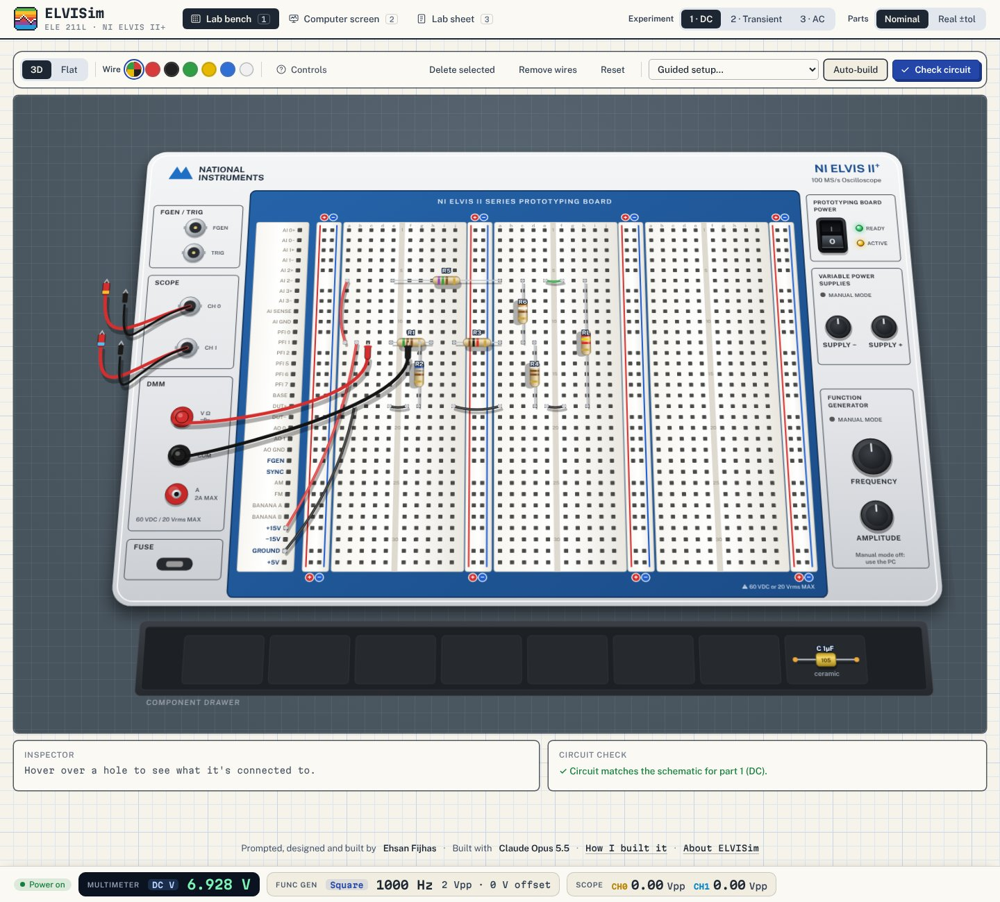

# ELVISim

A browser simulator of the **NI ELVIS II+** lab bench for practising the ELE 211L (Electric Circuits I) lab at the American University of Sharjah: DC measurements, Thevenin equivalents, RC transients and AC steady state.

**[▶ Open ELVISim](https://3hsann.github.io/elvisim/)** · [Go straight to the simulator](https://3hsann.github.io/elvisim/sim/) · [How I built it](https://3hsann.github.io/elvisim/build-log/)



## What it does

- **3D ELVIS II+ bench.** Breadboard, power rails, header pins (+15V, −15V, GROUND, +5V, FGEN), scope BNCs, DMM jacks and a working power switch.
- **Real wiring.** Drag jumper wires, place parts from the drawer, move each lead. DMM leads and scope clips plug in like the real ones.
- **Linked schematic.** Hover a part on the board and it lights up on the schematic; hover a node on the schematic and its holes light up on the board.
- **Auto-build in schematic orientation.** The reference build is laid out exactly like the lab schematic, the way instructors expect it.
- **Guided setups** for every measurement: V1, I1–I3, Voc, Isc, Rth, τ and the 1 kHz magnitude and phase.
- **Circuit solver.** Nodal (MNA) DC solver and a backward-Euler transient solver with an adaptive time step.
- **Computer screen tab.** Mock ELVISmx DMM, function generator and oscilloscope (Edge trigger, cursors per channel, autoscale).
- **Lab sheet** with procedure and a worksheet that checks your values within 3%.

## Verified against theory

| Quantity | Simulator | Hand calculation |
|---|---|---|
| V1 | 6.928 V | 6.928 V |
| I1 / I2 / I3 | 13.58 / −11.87 / 1.714 mA | same |
| Voc / Isc / Rth | 9.866 V / 23.83 mA / 413.9 Ω | same |
| τ = Rth·C | 0.414 ms | 0.414 ms |
| Vc at 1 kHz | 2.36 Vpp, −69° | same |

## Layout

```
index.html          landing page
sim/index.html      the simulator (single file, no build step)
build-log/          how it was built
assets/             shared styles and preview image
```

Hosted with GitHub Pages via `.github/workflows/static.yml`. Visits are counted with GoatCounter (no cookies).

---

Prompted, designed and built by **Ehsan Fijhas** · Built with **Claude Opus 5.5**
